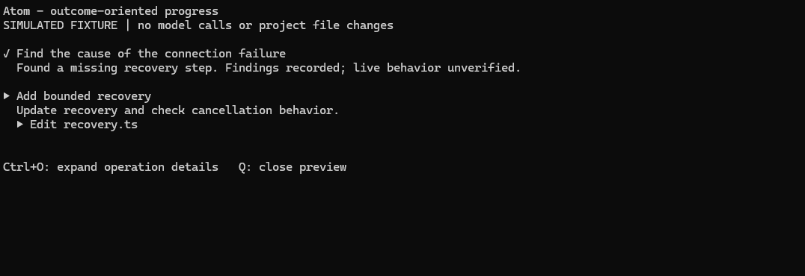

# Calm: progress and outcomes

Calm is an optional view of the work, not a list of tool names. Run `/calm` to toggle it. A fresh installation starts off; the preference is saved as `calm` in Pi's agent directory (`~/.pi/agent`, or `PI_CODING_AGENT_DIR`).

When enabled:

- One subtask card stays in place while operations run. Its title and summary describe the intended outcome and actual progress in the user's language.
- The agent explicitly reports `working`, `done` or `blocked` through `work_progress`. A finished tool never automatically becomes a finished subtask. Settlement without a completion report shows stopped/incomplete.
- The working card shows the latest three actual operations, with an earlier-operation count when needed. File operations show short filenames; arbitrary scripts are not parsed to guess their purpose.
- Completed cards retain their result and verification/limitations summary. These are agent reports, not independent proof of success. Earlier operation errors remain marked, including after a later completion report.
- Grouped operation rows are compacted away. Ctrl+O uses Pi's native expanded view for original calls/results. Failed tool results and image results remain visible even in the compact view.
- Tools without a reported subtask get a factual operation label, not an invented goal or result. Pi still controls reasoning visibility.
- The animated boat keeps its existing run/settlement lifecycle.

The renderer does not change operation execution, tool arguments, original results, permissions, model choice or authentication. This is **not purely presentation-only**: it adds one progress-tool declaration and, for interactive Calm runs where that tool is active, short guidance. Progress calls/results enter native session history so the view can be reconstructed without re-executing work. Normal tool-call tokens/turns can add latency; no extra model, classifier, provider request outside the agent loop, background service or task scheduler is introduced. Updates belong at meaningful boundaries, not every small operation. The progress tool is model-only, not callable inside codemode, so each reported card has a real transcript anchor.

Calm off restores native tool rendering. Non-interactive modes do not install a progress display or inject the interactive guidance; the registered progress tool is still available if selected. No global Pi settings are rewritten. Do not load a standalone Calm implementation alongside this bundled one.

## Preview and verification

`node scripts/preview-progress.mjs` opens a local, labelled simulated fixture using Pi's real loader, tool rows and terminal renderer. Ctrl+O expands/collapses, and Q exits. `--plain` prints a deterministic snapshot without a TTY. No model calls or project-file changes occur in this preview.

`npm test` includes strict TypeScript against the installed Pi declarations; actual loader/component width, image, error and expansion checks; saved-view reconstruction; and a deterministic native-Pi progress/write/result flow that checks a real disposable output file. See [verification and limits](../../../docs/progress-verification.md).

This revision is checked with Pi 1.4.0 and Node.js 24. The older implementation originated with Pi 0.85.1, which was not rerun here. The renderer probes the component API and reports a diagnostic if it is unavailable. Native keyboard expansion is retained; physical accessibility/screen-reader behavior and real-model progress-report quality have not been validated.

Adapted from Kun Chen's Pi Calm extension, itself adapted from Firstmate. See [LICENSE](LICENSE).
